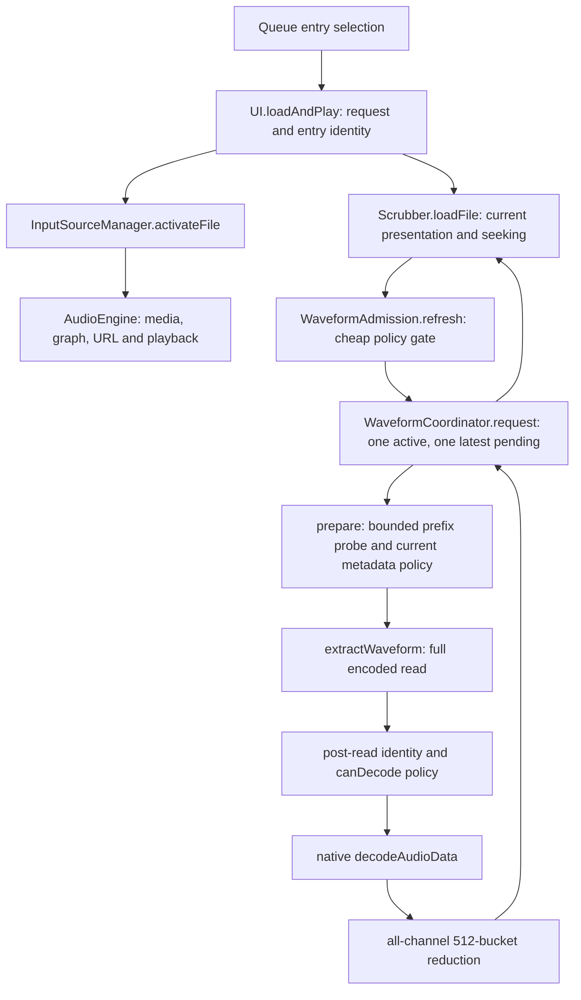

# Executable ownership reconstruction

The supplied assignment diagram needs one correction: bounded metadata work runs inside the coordinator's occupied preparation stage, not in an independent scheduler before the coordinator. Pure cheap policy evaluation also runs before scheduling.

| Ownership | Actual file / function |
| --- | --- |
| Queue identity and activation request | src/js/ui/ui.js / loadAndPlay, isCurrentFileRequest; src/js/audio/queue.js / currentEntry |
| Source acquisition/teardown | input-source-manager.js / activateFile, activateMic, activateStream, teardownActiveSource |
| Playback media/graph/URL and seek media reference | audio-engine.js / loadFile, getMediaEl, unload; Scrubber's seeking writes only currentTime |
| Recorder tap and finalization | AudioEngine recorder tap; RecorderEngine onTransportMutation/start/stop/dispose; UI's established EOF callback |
| Current optional intent, manual grant, three metadata listeners | waveform-admission.js / loadFile, reset, generate |
| Prefix byte/chunk inspection | waveform-metadata.js / probeWaveformMetadata, inspectPcmWavHeader; invoked only by coordinator prepare |
| Full encoded read/native decode/peak reduction | waveform-extractor.js / extractWaveform, buildWaveformPeaks |
| Resource slot and replaceable pending intent | waveform-coordinator.js / request, run, reset |
| Hard and convenience admission | waveform-policy.js / evaluateWaveformPolicy; CONFIG.waveform owns values |
| Only current completed peaks and presentation | scrubber.js / _waveform, draw; waveform-options.js / update |
| Local IDs only; independent scene state | application-preferences.js / initialize, set; preferences.js and preset codec remain scene owners |

Source search finds one bounded slice adapter, one full File.arrayBuffer extraction site, and one decodeAudioData site in production. No alternative optional decoder/read path, cache, worker, timeout/race, or animation-loop admission was found. This is source-level ownership evidence, not a proof of native garbage collection.

## Corrected transition and retention details

Admission reset/load uses a private revision fence (waveform-admission.js:91–105) to reject an older continuation after a newer synchronous load/Clear. Preference/metadata refresh while scheduled records one boolean (54–83); settlement reconciles it once through the same coordinator. This is not a second admission queue. Per-request manual grant is created false at load (106) and set only after fresh manual admission (117–124).

Coordinator occupancy is reserved before prepare/read and released only in run's finally after actual promise settlement. Reset invalidates generation and drops pending File intent but does not clear active occupancy. Failed/stale callbacks cannot commit; full read and native decode have separate post-await identity checks. No timeout or Promise.race exists. Reduction is synchronous, with an independent reentrant replacement check proving no replacement prefix/read begins inside it and stale peaks cannot commit.

The bridge retains one current File/media/metadata result; the coordinator retains active and newest pending descriptors. Reset nulls current File/media and removes its three listeners. Discarded pending promises and active continuations may persist until their ordinary microtask/operation settlement. UI identity closures can reference Queue entries, and Queue intentionally retains its files; these are not a waveform history/cache. After settlement there is no retained native AudioBuffer/channel-view cache; only one current 512-float peak array remains in Scrubber. Snapshot diagnostics contain scalars. These logical release properties do not prove native heap reclamation timing.

Policy/config are immutable source decisions; application runtime selects validated IDs outside scene runtime/preset schema 10. A waveform failure never calls playback unload, source teardown, seek, recorder stop or finalization. A source/media change revokes optional presentation immediately even if native work remains physically unabortable.
