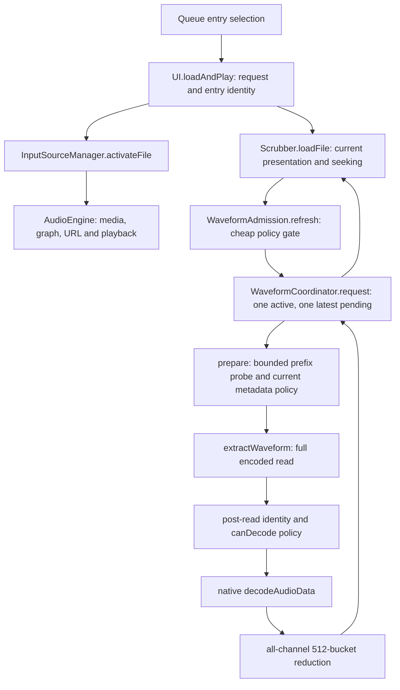

# Executable ownership reconstruction

The supplied assignment diagram needs one correction: bounded metadata work runs inside the coordinator's occupied preparation stage, not in an independent scheduler before the coordinator. Pure cheap policy evaluation also runs before scheduling.

| Ownership | Actual file / function |
| --- | --- |
| Queue identity and activation request | src/js/ui/ui.js / loadAndPlay, isCurrentFileRequest; src/js/audio/queue.js / currentEntry |
| Source acquisition/teardown | input-source-manager.js / activateFile, activateMic, activateStream, teardownActiveSource |
| Playback media/graph/URL and seek media reference | audio-engine.js / loadFile, getMediaEl, unload; Scrubber's seeking writes only currentTime |
| Recorder tap and finalization | AudioEngine recorder tap; RecorderEngine onTransportMutation/start/stop/dispose; UI's established EOF callback |
| Current optional intent, manual grant, three metadata listeners | waveform-admission.js / loadFile, reset, generate |
| Prefix byte/chunk inspection | waveform-metadata.js / probeWaveformMetadata, inspectPcmWavHeader; invoked only by coordinator prepare |
| Full encoded read/native decode/peak reduction | waveform-extractor.js / extractWaveform, buildWaveformPeaks |
| Resource slot and replaceable pending intent | waveform-coordinator.js / request, run, reset |
| Hard and convenience admission | waveform-policy.js / evaluateWaveformPolicy; CONFIG.waveform owns values |
| Only current completed peaks and presentation | scrubber.js / _waveform, draw; waveform-options.js / update |
| Local IDs only; independent scene state | application-preferences.js / initialize, set; preferences.js and preset codec remain scene owners |

Source search finds one bounded slice adapter, one full File.arrayBuffer extraction site, and one decodeAudioData site in production. No alternative optional decoder/read path, cache, worker, timeout/race, or animation-loop admission was found. This is source-level ownership evidence, not a proof of native garbage collection.
